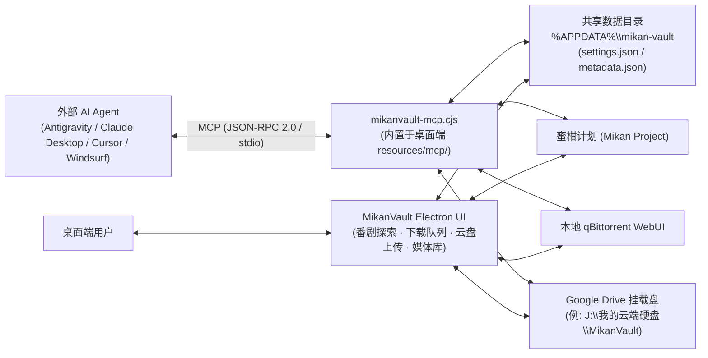

# MikanVault · 蜜柑追番库 & 内置 MCP AI 助手

**MikanVault** 是一款面向番剧收藏者的桌面端与 AI Agent 协同应用，整合了 **蜜柑计划（Mikan Project）探索搜番**、**qBittorrent 队列管理与 RSS 自动追更**、**Google Drive 谷歌云盘传输中心**、**本地/云端双模番剧媒体库**，并原生内置 **MCP（Model Context Protocol）Server**，让外部 AI Agent 可直接替你找番、推下载、管订阅和上传云盘。

---

## 系统架构

桌面端应用与内置 MCP 助手共享同一个数据目录（Windows 默认为 `%APPDATA%\mikan-vault` 下的 `settings.json` 与 `metadata.json`），文件签名变更会自动跨进程刷新：



---

## 桌面端核心功能

1. **番剧探索 / 搜番 / 最新 RSS**
   - 浏览本季与历年番剧放送表，支持全站搜番与历年季度筛选。
   - 番剧详情页、订阅弹窗与搜索筛选均完整展开所有字幕组（不会被数量上限截断），支持单集/批量推送至 qBittorrent，并可在批量下载弹窗一键勾选 **「同时开启自动订阅追更」**。
2. **qBittorrent 下载管理与自动追更**
   - 自动检测本机 `qBittorrent.ini` 端口/账号并支持一键拉起客户端；按番剧名自动新建独立子目录。
   - 下载完成自动转存谷歌云盘时，先走本地磁盘避免 BT 随机读写对虚拟盘造成锁死或卡顿，完成后再常规复制到云盘并逐文件校验字节大小。
3. **谷歌云盘传输中心（独立管理界面）**
   - 左侧导航 **「云盘上传」** 页面实时展示 Google Drive 挂载盘状态、缓冲可用容量、正在上传任务、等待下完转存任务与历史记录。
   - **完整控制操作**：支持查看实时文件进度、点击 **「取消上传」**（正在传输或排队均可安全取消，**绝不删除本地源文件**）、失败/取消后一键 **「重新上传」**、打开云盘目标文件夹，以及点击 **「选择本地番剧上传」** 直接从本地媒体库批量上云。
4. **本地 & 云端媒体库**
   - 自动同时扫描本地动漫目录与 Google Drive 目录，云端番剧卡片自动带有 `☁️ 云盘` 徽章。
   - 右键番剧卡片或进入详情页即可一键 **刮削元数据**、**上传到谷歌云（并删除本地）**、**上传到谷歌云（保留本地）**，校验通过后自动迁移海报封面、评分与已看/未看播放进度。
5. **设置与内置 MCP 一键配置**
   - 在 **「偏好设置 → 内置 MCP AI 助手」** 可直接查看本机 MCP 脚本路径、共享数据目录，并 **一键复制标准 JSON 配置**。

> **Google Drive 空间小贴士**  
> 在 Google Drive Desktop「偏好设置 → Google 云端硬盘」中选择 **流式传输文件（Stream files）** 并可将本地缓存目录从 C 盘迁移到大容量硬盘（如 `H:\DriveFSCache`），即可在享受 5TB 等云端容量的同时避免占用双份本地空间或挤满 C 盘。

---

## 内置 MCP AI 助手接入指南

MikanVault 内置标准 **MCP JSON-RPC 2.0（stdio）** 服务端，不依赖 Electron 窗口运行；只要安装 Node.js (>= 20) 即可随时响应任意 AI Agent 的工具调用。

### 1. 服务入口位置
- **已打包桌面版直接内置**：`<MikanVault 安装/解压目录>\resources\mcp\mikanvault-mcp.cjs`  
  （打包产物位于 `release\win-unpacked\resources\mcp\mikanvault-mcp.cjs`）
- **源码编译产物**：`dist-mcp/mikanvault-mcp.cjs`（通过 `npm run build:mcp` 构建）

### 2. 一键接入配置（通用 JSON）
最简单方式：打开 MikanVault 桌面端 → **「偏好设置」** → 拉到底部 **「内置 MCP AI 助手」** → 点击 **「一键复制配置」**。

或参考下面模板（与 [`mcp/mcp-config.example.json`](mcp/mcp-config.example.json) 一致）：

```json
{
  "mcpServers": {
    "mikanvault": {
      "command": "node",
      "args": [
        "C:\\Path\\To\\MikanVault\\resources\\mcp\\mikanvault-mcp.cjs"
      ],
      "env": {
        "MIKANVAULT_DATA_DIR": "C:\\Users\\<YourName>\\AppData\\Roaming\\mikan-vault"
      }
    }
  }
}
```

#### 各主流 AI 客户端配置路径
- **Antigravity**：在 MCP Servers 配置中添加上述 `mikanvault` 条目即可自动发现 16 个工具、6 个资源和 2 个工作流 Prompt。
- **Claude Desktop**：添加到 `%APPDATA%\Claude\claude_desktop_config.json` 的 `mcpServers` 中并重启 Claude Desktop。
- **Cursor**：添加到项目 `.cursor/mcp.json` 或全局 `~/.cursor/mcp.json`。
- **Windsurf**：添加到 `~/.codeium/windsurf/mcp_config.json`。

#### 可选环境变量
| 变量名 | 说明 | 默认值 |
|---|---|---|
| `MIKANVAULT_DATA_DIR` | 指定 MikanVault 配置与元数据目录 | 自动定位到系统 `%APPDATA%\mikan-vault`（与桌面端共享） |
| `HTTPS_PROXY` / `HTTP_PROXY` | Node 环境下访问蜜柑的代理地址（如需） | 读取系统环境代理 |

---

## MCP 能力完整清单

### Tools（16 个工具）

#### 1. 找番、排期与媒体库查询
| 工具名 | 核心参数 | 说明 |
|---|---|---|
| `mikan_search` | `query` (string, 必填), `limit?` (number) | 在蜜柑计划搜索番剧条目与字幕组种子列表 |
| `mikan_get_schedule` | `year?` (number), `season?` (`春/夏/秋/冬`) | 获取当季或指定季度的每日放送表 |
| `mikan_get_bangumi_detail` | `bangumiId` (string, 必填), `subgroupId?`, `expandEpisodes?` | 获取番剧封面、简介、所有字幕组 RSS 与剧集种子 |
| `library_scan` | `query?`, `onlyLocal?` (boolean), `onlyCloud?` (boolean) | 扫描本地与谷歌云盘媒体库（返回 `seriesId`、集数、播放进度、`isCloud`） |
| `library_scrape` | `seriesId?`, `query?`, `scrapeAll?`, `forceAll?` | 刮削单部或全部未刮削番剧的封面与元数据 |

#### 2. qBittorrent 下载与自动追更
| 工具名 | 核心参数 | 说明 |
|---|---|---|
| `qb_status` | `filter?` (`all/downloading/completed/paused`) | 检测 qB WebUI 连接状态并查看当前下载队列与速度 |
| `qb_launch` | 无 | 自动启动本地 qBittorrent 客户端 |
| `qb_add_download` | `items` (必填数组), `offloadToGoogleDrive?`, `deleteLocalAfterCloudMove?` | 推送单集/批量种子或磁力到 qB，可选下完自动转存谷歌云盘 |
| `qb_control_torrent` | `hash` (string, 必填), `action` (`pause/resume/delete/deleteWithFiles`) | 暂停、恢复或移除 qB 下载任务 |
| `subscription_list` | `includeLogs?` (boolean) | 列出所有自动追更订阅规则与最近抓取日志 |
| `subscription_upsert` | `bangumiId`, `bangumiTitle`, `subgroupId`, `subgroupName`, `startAfterEpisode?`, `offloadToGoogleDrive?`, ... | 创建或更新 RSS 自动追更规则（可自动转存云盘） |
| `subscription_check_now` | `subscriptionId?` | 立即触发一次 RSS 更新检查并自动拉起下载 |

#### 3. Google Drive 谷歌云盘上传与控制
| 工具名 | 核心参数 | 说明 |
|---|---|---|
| `cloud_status` | `statusFilter?` (`all/queued/copying/completed/failed/cancelled`) | 查看谷歌云盘挂载路径、可用空间及全部上传/转存任务状态 |
| `cloud_upload_library` | `deleteLocal` (boolean, 必填), `seriesId?`, `seriesTitle?`, `episodeNumbers?`, `background?` | 按 `seriesId` 或模糊番剧名将本地媒体库番剧/单集上传至谷歌云盘并保留封面/进度 |
| `cloud_cancel_job` | `jobId` (string, 必填) | 取消排队中或正在复制的云盘上传任务（不删除本地源文件） |
| `cloud_process_now` | 无 | 立即检查已下完的 qB 转存任务并执行云盘搬运（含失败重试） |

### Resources（6 个只读资源）
- `mikanvault://guide`：Markdown 格式的 Agent 工作流速查说明
- `mikanvault://settings`：当前应用配置（自动脱敏 `qbPassword`）
- `mikanvault://library`：扫描后的完整媒体库 JSON
- `mikanvault://torrents`：qBittorrent 连接状态与当前任务队列 JSON
- `mikanvault://cloud-jobs`：谷歌云盘状态与上传任务列表 JSON
- `mikanvault://subscriptions`：自动追更规则与日志 JSON

### Prompts（2 个预设工作流）
- `find_and_download_anime`（`query`, `to_cloud?`）：搜番 → 确认字幕组 → 推 qB 下载并可选上云
- `offload_local_library_to_cloud`（`title?`, `delete_local?`）：扫描本地库 → 核对云盘空间 → 安全上传与删/留本地

---

## 对话示例（直接这样对 AI Agent 说）
- 「帮我用 MikanVault 搜一下《葬送的芙莉莲》，看下哪个字幕组有 1080p 合集。」
- 「把这一季第 8 集推送到 qBittorrent 下载，下完帮我转存到谷歌云盘并删掉本地文件，顺便开启自动追更。」
- 「帮我看看本地媒体库有哪些番还没上传到谷歌云盘，把《钢之炼金术师》上传过去并删除本地释放空间。」
- 「查看一下当前谷歌云盘上传进度，取消正在传的那个任务。」

---

## 开发、测试与打包命令

```powershell
# 安装依赖
npm install

# 开发模式（Vite + Electron 热重载）
npm run dev

# 类型检查
npm run typecheck

# 运行全部 Vitest 单元测试
npm test

# 单独编译独立 MCP Server (生成 dist-mcp/mikanvault-mcp.cjs)
npm run build:mcp

# 全量构建并打包桌面端目录（同时把 MCP 内置到 release\win-unpacked\resources\mcp\）
npm run pack
```
